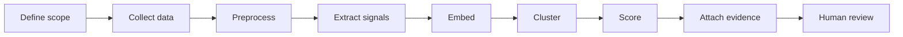
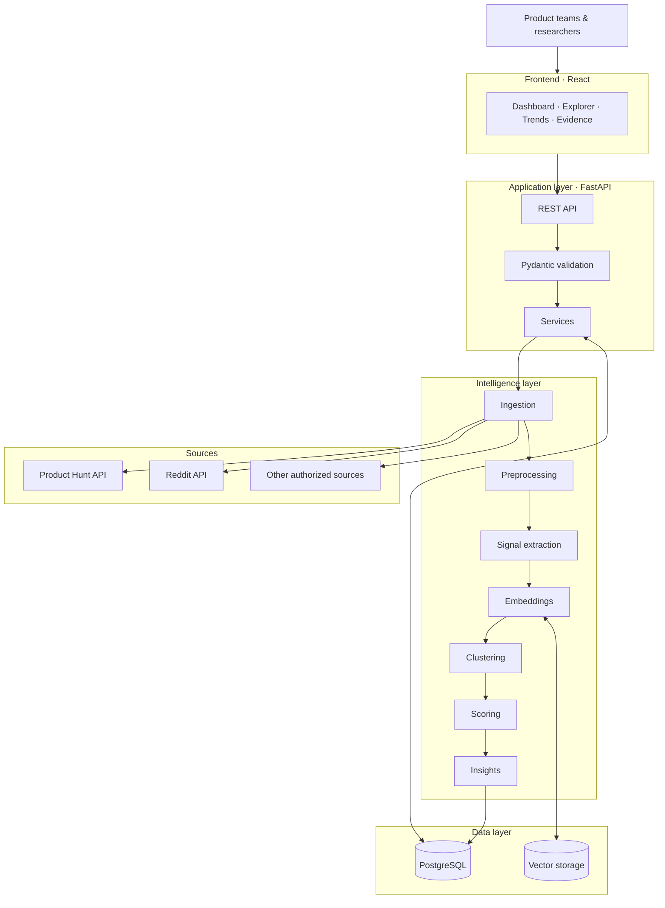
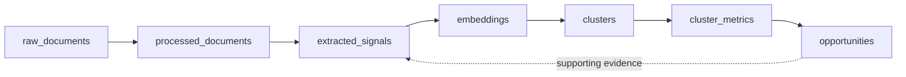

<div align="center">

# GreatScout

### Evidence-backed product opportunity discovery

**Scout Smart, Build Better.**
Discover problems.Validate opportunities.Build with evidence.


[Overview](#overview) · [How it works](#how-it-works) · [Architecture](#architecture) · [Scoring](#opportunity-scoring) · [API](#api) · [Getting started](#getting-started) · [Roadmap](#roadmap)

</div>


## Overview

Product teams rarely lack feedback.They lack a way to read it. Real user needs are scattered across communities, written in inconsistent language, and buried in thousands of threads no one has time to analyze by hand.

**GreatScout turns that noise into ranked, traceable opportunities.** It ingests public discussions, extracts pain points and feature requests, groups similar problems with semantic analysis, scores each cluster on measurable evidence, and shows every insight next to the source records that support it.

> **Evidence → Pattern → Opportunity → Product Insight**

GreatScout does not hand you generic product ideas.It shows you *why* an opportunity matters and *what proves it*.

---

## What you get

| Capability | What it does |
|---|---|
| **Market data ingestion** | Collects public discussions and product feedback from authorized sources |
| **Preprocessing** | Cleans, normalizes, and de-duplicates records; rejects malformed data |
| **Signal extraction** | Identifies pain points, feature requests, and unmet needs |
| **Semantic analysis** | Recognizes the same problem described in different words |
| **Opportunity clustering** | Groups related signals into coherent patterns |
| **Opportunity scoring** | Ranks clusters using explicit, documented metrics |
| **Evidence traceability** | Links every insight back to its original source records |
| **Trend analysis** | Surfaces recurring themes and shifts in market signals |
| **Interactive dashboard** | Explore opportunities, clusters, and evidence in one place |

> Availability of individual capabilities depends on the current implementation and configured data sources.

---

## How it works



1. **Collect.** Pull records from authorized sources such as Product Hunt and Reddit.
2. **Preprocess.** Validate, normalize, and clean. Invalid records are logged or rejected, never silently kept.
3. **Extract.** NLP isolates structured signals: pain points, feature requests, unmet needs.
4. **Embed and cluster.** Semantic similarity groups differently worded signals into one problem.
5. **Score.** Each cluster is measured on recurrence, engagement, urgency, and evidence diversity.
6. **Explain.** Every ranked opportunity carries its supporting signals and source references.
7. **Validate.** A human reviews, challenges, and decides.

---

## Architecture



> This is the intended logical architecture. Verify connectors, storage choices, and modules against the repository configuration.

### Data model



| Entity | Purpose |
|---|---|
| Raw documents | Preserve source records and ingestion metadata |
| Processed documents | Cleaned, normalized records |
| Extracted signals | Identified problems and user needs |
| Embeddings | Vectors for semantic similarity |
| Clusters | Groups of related signals |
| Cluster metrics | Measurements used to evaluate clusters |
| Opportunities | Ranked product opportunity candidates |

These are logical names, not a guarantee of exact table names.

---

## Opportunity scoring

Scores are built from four measurable dimensions:

| Metric | Question it answers |
|---|---|
| **Recurrence** | How often does this problem appear? |
| **Engagement** | How much do people react to it? |
| **Urgency** | How strongly is the need expressed? |
| **Evidence diversity** | Does it appear across independent sources and authors? |

Scoring should use documented metrics, consistent normalization, configurable weights where appropriate, and explicit handling of missing data.

Each opportunity should include:

- A concise problem statement
- Supporting signals and source references
- The number of relevant records
- The metrics behind its score
- Confidence and data-quality notes
- Assumptions and limitations

> A high score marks a candidate worth investigating. It does not guarantee demand, feasibility, or commercial success.

---

## Interface

| Module | Purpose |
|---|---|
| **Home** | Entry point and workflow overview |
| **Market dashboard** | Radar of clusters, signal distribution, velocity |
| **Opportunity explorer** | Ranked opportunities, competitor gaps, deep dives |
| **Signal explorer** | Extracted pain points and feature requests |
| **Trend analysis** | Topic growth and recurring themes over time |
| **Evidence view** | Verbatim source records behind every insight |

The guiding rule is traceability: from any opportunity summary, a user should reach its supporting evidence in a click or two.

---

## API

GreatScout exposes a REST API between frontend and backend.

| Function | Example endpoint |
|---|---|
| Health check | `GET /health` |
| List clusters | `GET /clusters` |
| Cluster details | `GET /clusters/{id}` |
| List opportunities | `GET /opportunities` |
| Opportunity details | `GET /opportunities/{id}` |
| Trends | `GET /trends` |

> These are candidate patterns. The OpenAPI specification and backend route definitions are the source of truth.

---

## Tech stack

| Layer | Technology |
|---|---|
| Frontend | React, JavaScript, CSS |
| Motion | GSAP, Lenis *(where configured)* |
| Backend | Python, FastAPI, Pydantic |
| Data access | SQLAlchemy, Alembic |
| Database | PostgreSQL, pgvector *(if configured)* |
| AI processing | NLP, embeddings, clustering |
| Data sources | Authorized external APIs |
| Testing | Automated backend and frontend tests |
| Deployment | Docker *(if configured)* |

Check dependency manifests before treating every item as installed.

---

## Getting started

> Replace the placeholders below with the repository's actual commands.

```bash
# 1. Clone
git clone <repo-url> && cd greatscout

# 2. Configure secrets (never commit these)
cp .env.example .env   # add API credentials and database URL

# 3. Backend
cd backend
pip install -r requirements.txt
alembic upgrade head
uvicorn app.main:app --reload

# 4. Frontend
cd ../frontend
npm install
npm run dev
```

---

## Roadmap

Each stage is complete only when its implementation **and** tests are verified.

| Stage | Done when |
|---|---|
| Data ingestion | Sources are accessed and records persisted reliably |
| Preprocessing | Invalid, duplicate, and malformed records are handled |
| Signal extraction | Structured signals are generated and evaluated |
| Semantic analysis | Embeddings and clusters are validated |
| Opportunity scoring | Scores are reproducible and explainable |
| API integration | Endpoints return validated, consistent responses |
| Frontend integration | Dashboard consumes real backend data |
| End-to-end validation | The full workflow passes integration tests |

Build incrementally: reliable ingestion first, then extraction, clustering, scoring, API, and dashboard.

---

## Principles

1. **Evidence before assumptions.** Every opportunity traces to real signals.
2. **Patterns before recommendations.** Find the problem, then rank it.
3. **Transparent scoring.** Criteria are understandable and testable.
4. **Reliable data.** Data quality decides insight quality.
5. **Explainable outputs.** Users can see why something was surfaced.
6. **Human validation.** AI supports decisions; it does not prove viability.
7. **Incremental delivery.** Test each stage before the next depends on it.

---

## Security and reliability

- Use authorized data sources and respect their access policies
- Keep credentials in environment variables or a secrets manager
- Validate and normalize all external data before processing
- Apply request validation, access controls, and sensible CORS settings
- Handle rate limits, failures, and unavailable sources safely
- Never present unsupported AI-generated claims as verified evidence
- Test scoring and clustering on representative datasets

---

## Documentation

- `README.md`: overview, architecture, setup
- `openapi.yaml`: API contract *(if maintained)*
- `PRD.md`: requirements and acceptance criteria
- Architecture docs: component responsibilities and data flow
- Database migrations: authoritative schema history
- Test docs: validation procedures

---

<div align="center">

**GreatScout. Scout Smart, Build Better.**

Turn market signals into patterns, evidence-backed opportunities, and better product decisions.

</div>
